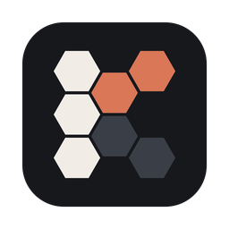

<p align="center"></p>

<h1 align="center">Kovan</h1>

<p align="center">Tells you what is blocked on you, and hands it to a coding agent.</p>

Kovan is a macOS app for developers who work across GitHub, Jira and Sentry. It
shows which pull requests, tickets and errors need you, and lets you hand each
one to a coding agent (Claude Code, Codex or OpenCode) running in a terminal
next to it. Each agent shows whether it is working, needs your input, or is
done, and its session keeps running after you quit Kovan.

*Kovan* is Turkish for beehive.

This repository holds the downloads. The source code is at
[idrisay/kovan](https://github.com/idrisay/kovan) (MIT), and the website is
[kovan.ch](https://kovan.ch).

## Install

Requires a Mac with Apple silicon (M1 or later) and macOS 13 or later.

1. Download **`Kovan-0.3.0-arm64.dmg`** from the [latest release](https://github.com/idrisay/kovan-releases/releases/latest).
2. Open it and drag **Kovan** into **Applications**.
3. Open Kovan from Applications. macOS will say it can't check Kovan for
   malicious software, because the app isn't notarised by Apple yet. Click
   **Done**, then open **System Settings › Privacy & Security**, scroll down
   to the message about Kovan, and click **Open Anyway**. You only do this
   once.

If you prefer the Terminal, this does the same as step 3:

```sh
xattr -dr com.apple.quarantine /Applications/Kovan.app
```

## First run

Kovan starts with nothing connected. Click **Connect a service** and add a
token for GitHub, Jira or Sentry. To hand work to an agent, install the agent's
command line tool first (`claude`, `codex` or `opencode`).

Tokens are encrypted with your Mac's Keychain and stay on your Mac. Kovan talks
only to the services you connect.

## Checking the download

Each release lists SHA-256 checksums in `SHA256SUMS.txt`:

```sh
shasum -a 256 -c SHA256SUMS.txt
```

## Updating

Quit Kovan, download the new release, and drag it into Applications again,
replacing the old copy. Your settings and connections are kept.

## Feedback

Found a bug or have an idea? [Open an issue](https://github.com/idrisay/kovan/issues).
